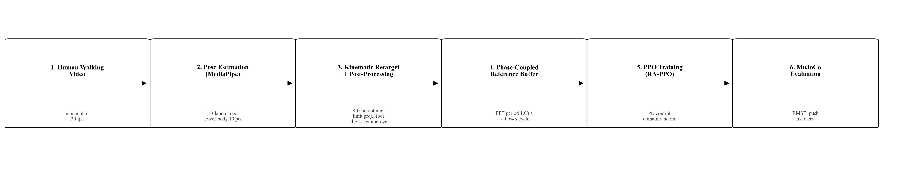
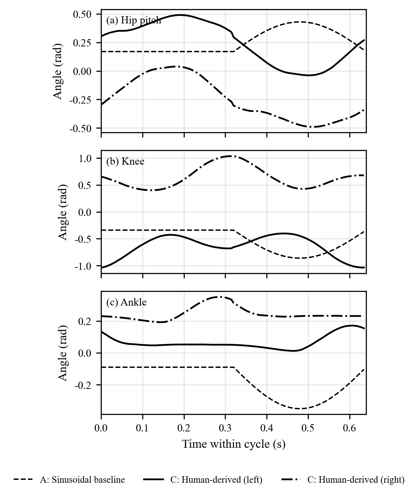

# Video-Derived Gaits for Low-Cost 10-DoF Humanoids

Official implementation of **"When Less Imitation Is More: Lightweight Phase-Coupled Tracking of Video-Derived Gaits for Low-Cost 10-DoF Humanoids"** (ROBIO 2026).

[](LICENSE)
[](https://www.python.org/)
[](https://mujoco.org/)
[](https://mediapipe.dev/)

A **MoCap-free** pipeline that turns *one monocular smartphone video* of a walking person into a
natural gait for a 10-DoF humanoid — no motion-capture rig, no large-scale motion dataset.



> 中文简介见文末 [中文说明](#中文说明)。

---

## Key idea

Most imitation pipelines put the reference trajectory **into the policy observation**, which on a
low-DoF robot makes the explicit tracking objective compete with the few joints that actually keep
the robot upright. We show that on a 10-DoF platform **less imitation is more**:

* the reference is used to **shape the reward** and to **initialise** the gait phase,
* it is **deliberately excluded from the observation**,
* the policy therefore keeps full authority over balance.



## Results

Four conditions, 5×10⁶ steps each, evaluated over 20 episodes. B and C use seeds 42/100/200;
D is single-seed; A reuses the published RA-PPO model without retraining.

| Condition | Reference | Status |
|---|---|---|
| **A** | sinusoidal (prior work) | single model |
| **B** | video-derived + explicit `0.5 r_vel + 0.5 r_stance` | 3 seeds |
| **C** | video-derived + **lightweight phase coupling (ours)** | 3 seeds |
| **D** | video-derived, **no smoothing / no L-R symmetrisation** | single seed |

* **C vs. A: +23.9%** total reward; **75% push recovery** across three seeds.
* **C vs. B: +9.9%** — the lightweight phase-coupled formulation beats the explicit
  velocity/stance-alignment rewards while keeping the same policy architecture.
* **C vs. D: 20.0%** — omitting only Savitzky–Golay smoothing and L/R symmetrisation costs
  a fifth of the reward, which isolates the contribution of the reference-processing chain.
* Seed-level inference (10k bootstrap): **CI [49, 364]**, Hedges' **g = 1.39**.
* Mean absolute torque at seed 42, 0.4 m/s: **60.6% lower** for C than B — a descriptive
  actuation-effort proxy, *not* an energy-efficiency measurement.

## The pipeline

```
video ──► MediaPipe pose ──► Savitzky–Golay smoothing ──► FFT stride period
      ──► cycle alignment + multi-cycle averaging ──► 120-point phase resampling
      ──► L/R half-cycle symmetrisation ──► robot mapping + scaling
      ──► joint-limit clipping ──► phase-indexed reference (120 × 10)
```

Each stage is an independent, auditable script in [`scripts/`](scripts), and every stage has a
verification harness (`gate1_verify.py` checks swing amplitude, anti-phase correlation, joint
limits and stance consistency before any training starts).

### Demo

Side-by-side human / robot comparison (12 s):
[`demos/human_robot_sync_12s.mp4`](demos/human_robot_sync_12s.mp4)

---

## Repository layout

```
pandaman-video-gait/
├── config.py, networks.py, pandaman_env*.py   # environment + policy (shared with RA-PPO)
├── train_robio.py        # training entry point (conditions A / B / C / D)
├── eval_robio.py         # 4-condition evaluation, --multiseed aggregate
├── eval_stats.py         # per-episode statistics, bootstrap CI, effect sizes
├── eval_robio_extra.py   # speed profile + gait-naturalness metrics
├── verify_a_rmse.py      # reference-tracking RMSE of condition A
├── show_robio.py         # interactive viewer
├── scripts/              # pose → reference → figures pipeline
├── data/landmarks/       # MediaPipe output for the source video (356 frames)
├── data/reference/       # smoothed (C) and unsmoothed (D) phase-indexed references
├── results/              # released models + evaluation JSONs
├── figures/              # paper figures and the scripts that generate them
└── assets/robots/pandaman/
```

---

## Installation

```bash
git clone https://github.com/1298346618-del/pandaman-video-gait.git
cd pandaman-video-gait

conda create -n videogait python=3.8 -y
conda activate videogait

pip install torch==2.0.1 --index-url https://download.pytorch.org/whl/cu118
pip install -r requirements.txt
```

`requirements.txt` pins **MuJoCo 2.3.3**, **Stable-Baselines3 2.4.1** and **MediaPipe 0.10.18**,
exactly as used in the paper.

> ⚠️ **MuJoCo ≥ 3.1 users:** `assets/robots/pandaman/mjcf/pandaman.xml` contains the legacy
> `<flag sensornoise="enable">` attribute that newer MuJoCo rejects. Either install
> `mujoco==2.3.3`, or delete **only** that token (keep `frictionloss="enable"`, which affects
> the dynamics of a joint with `frictionloss="0.01"`). The `scripts/` pipeline already ships a
> compatibility shim (`load_model_compat`) for forward-kinematics use.

> **No GPU?** Scripts default to `device="cuda"`; change it to `"auto"` for CPU evaluation.

---

## Quick start

### 1. Re-run the pipeline from the shipped landmarks

The source video is **not redistributed** (stock footage, see [`data/README.md`](data/README.md)),
but its MediaPipe landmarks are shipped, so every downstream stage is reproducible as-is:

```bash
python scripts/viz_landmarks.py          # inspect landmarks      → figures/d1_landmark_traj.png
python scripts/retarget.py               # landmarks → reference  → data/reference/reference_traj.npy
python scripts/retarget_raw.py           # ablation-D reference   → data/reference/reference_traj_raw.npy
python scripts/export_phase_info.py      # stance mask            → data/reference/ref_stance.npy
python scripts/gate1_verify.py           # sanity gates on the reference
python scripts/viz_reference.py          # plot the reference     → figures/d2_reference_traj.png
python scripts/viz_mapping.py            # human↔robot joint map  → figures/fig_mapping_*.png
```

To start from your **own** video instead:

```bash
python scripts/extract_pose.py path/to/your_video.mp4 data/landmarks
python scripts/retarget.py
```

### 2. Evaluate the released models

```bash
git lfs install && git lfs pull         # fetch the released .zip models (~400 MB)
python eval_robio.py --multiseed        # conditions B / C across 3 seeds → results/comparison_robio.json
python eval_stats.py                    # bootstrap CI + effect sizes    → results/stats_per_episode.json
python eval_robio_extra.py              # speed profile + naturalness    → results/robio_extra.json
```

Watch a policy walk:

```bash
python show_robio.py --model results/robio_ablation_s42/final_model.zip --ref_mode human
```

### 3. Retrain

```bash
# condition C (ours): video reference, lightweight phase coupling
python train_robio.py --run ablation --seed 42

# condition B: video reference + explicit velocity/stance rewards
python train_robio.py --run human --seed 42

# condition D: reference without smoothing / L-R symmetrisation
python train_robio.py --run ablation --seed 42 \
    --ref_path data/reference/reference_traj_raw.npy

# condition A: sinusoidal reference (reproduces the prior RA-PPO policy)
python train_robio.py --run baseline --seed 42
```

Seeds 42 / 100 / 200 reproduce the paper's multi-seed table. ~5×10⁶ steps on one RTX 4060.

### 4. Regenerate the figures

```bash
python scripts/make_figures.py      # reference, training curves, metrics
python scripts/make_figures_v2.py   # Fig. 1 pipeline diagram, Fig. 4 metrics
```

---

## Results files

| File | Content |
|---|---|
| `results/comparison_robio.json` | per-condition evaluation (reward, push recovery, …) |
| `results/stats_per_episode.json` | per-episode records → paired tests, bootstrap CI |
| `results/robio_extra.json` | speed profile + gait naturalness (cadence, slip, torque) |
| `results/a_rmse_verify.json` | tracking RMSE of the sinusoidal baseline A |
| `results/cohens_d_verify.json` | effect-size verification |

## Released models

| Path | Condition |
|---|---|
| `results/improved_ab/best/best_model.zip` | **A** — sinusoidal reference (prior work, reused) |
| `results/robio_human_s{42,100,200}/final_model.zip` | **B** — video ref + explicit rewards |
| `results/robio_ablation_s{42,100,200}/final_model.zip` | **C** — ours |
| `results/robio_ablation_raw_s42/final_model.zip` | **D** — no smoothing / no symmetrisation |

Stored with Git LFS. Intermediate 50k-step checkpoints are not distributed; they are
regenerable with `train_robio.py`.

---

## Attribution

* Robot description (`assets/robots/pandaman/`): BSD-3-Clause, © Beijing RobotEra Technology,
  from the Humanoid-Gym / legged_gym lineage — see
  [`assets/robots/pandaman/NOTICE.md`](assets/robots/pandaman/NOTICE.md).
* Policy architecture and environment are shared with the companion RA-PPO release:
  [Pandaman-rappo](https://github.com/1298346618-del/Pandaman-rappo).
* Built with [Stable-Baselines3](https://github.com/DLR-RM/stable-baselines3),
  [MediaPipe](https://mediapipe.dev/), [MuJoCo](https://mujoco.org/).

## Citation

```bibtex
@inproceedings{wu2026less,
  title     = {When Less Imitation Is More: Lightweight Phase-Coupled Tracking of
               Video-Derived Gaits for Low-Cost {10-DoF} Humanoids},
  author    = {Wu, Qingtian and Chen, Xu and Yan, Xiaohu and Yang, Ou and Yang, Jinfeng},
  booktitle = {IEEE International Conference on Robotics and Biomimetics (ROBIO)},
  year      = {2026}
}
```

## License

[MIT](LICENSE) for our code; third-party assets keep their original licenses.

---

## 中文说明

本仓库是论文 **《When Less Imitation Is More: Lightweight Phase-Coupled Tracking of
Video-Derived Gaits for Low-Cost 10-DoF Humanoids》(ROBIO 2026)** 的官方代码。

**核心贡献**：只需**一段手机拍摄的侧面行走视频**，无需动捕设备、无需大规模动作数据集，即可让
10 自由度低成本人形机器人学到自然步态。

**关键发现**：在低自由度平台上"**少模仿反而更好**"——把参考轨迹放进策略观测会与真正决定平衡的
少数关节"抢控制权"。我们的做法是用参考轨迹**塑形奖励 + 初始化相位**，但**不放进观测**，
策略因此保留完整的平衡控制权。相比显式速度/支撑相奖励（条件 B）提升 **9.9%**，相比正弦参考
基线（条件 A）提升 **23.9%**，抗推动恢复率 **75%**。

**处理链**：MediaPipe 姿态估计 → Savitzky–Golay 平滑 → FFT 步态周期估计 → 周期对齐与多周期
平均 → 120 点相位重采样 → 左右半周期对称化 → 机器人关节映射与缩放 → 关节限位裁剪。

**快速开始**：

```bash
pip install -r requirements.txt
python scripts/gate1_verify.py          # 校验参考轨迹
git lfs install && git lfs pull
python eval_robio.py --multiseed        # 复现条件 B / C
python show_robio.py --model results/robio_ablation_s42/final_model.zip
```

原始视频为 Mixkit 商用素材（ID 4855），**不随仓库分发**；其 MediaPipe 关键点已提供，
因此下游全流程可直接复现（见 `data/README.md`）。
